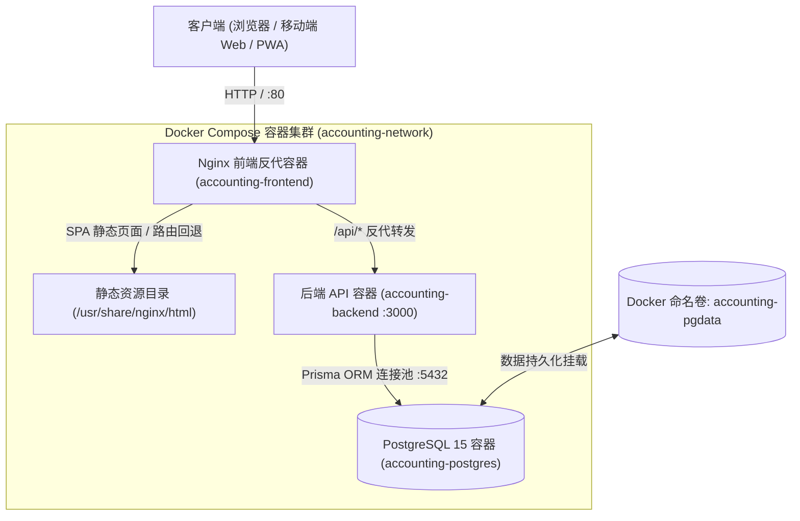

# 个人记账本 MVP 容器化部署、CI/CD 与本地环境配置交付报告

本文档针对「个人记账本」MVP 阶段的容器化架构、本地极速启动脚本、服务健康检查探针以及全流程 CI/CD 自动化流水线提供完整的技术方案与实例文档。

---

## 1. 架构与部署概览

基于 **TASK-3** 的全栈 TypeScript 选型，部署架构采用标准的三层容器拓扑：
- **Web 反向代理与静态前端**：`React + Vite + Tailwind` 打包产物由轻量高效的 `Nginx 1.25 Alpine` 驱动，内置 Gzip 压缩与静态资源 6 个月强缓存策略，同时将 `/api/` 路由透明代理至后端。
- **业务 API 服务**：`Node.js 20 LTS Alpine` 驱动 Fastify 后端，集成 Prisma ORM 客户端与 Zod 校验，以非 root 用户 (`appuser`) 安全运行。
- **数据存储持久层**：`PostgreSQL 15 Alpine` 提供强事务、高精度金额计算与时区处理，数据挂载于宿主机 Docker Volume (`accounting-pgdata`)。



---

## 2. 交付文件清单

| 类别 | 文件路径 | 核心作用说明 |
| :--- | :--- | :--- |
| **容器定义** | `deploy/docker/Dockerfile.backend` | 后端多阶段构建 Dockerfile，集成 Prisma CLI、OpenSSL、安全非 root 用户及探针 |
| **容器定义** | `deploy/docker/Dockerfile.frontend` | 前端 SPA 构建与 Nginx 托管多阶段 Dockerfile |
| **启动编排** | `deploy/docker/docker-entrypoint.sh` | 后端容器启动脚本，具备 Prisma 自动数据迁移能力 |
| **网关代理** | `deploy/nginx/nginx.conf` | Nginx 反向代理、Gzip 压缩、SPA History 路由与 `/health` 探针配置 |
| **多服务编排** | `docker-compose.yml` | 一键拉起 Postgres、Backend、Frontend，包含健康检查依赖链与网络配置 |
| **环境配置** | `.env.example` | 涵盖应用运行环境、PostgreSQL 连接串、端口与安全密钥的环境变量规范模板 |
| **CI/CD** | `.github/workflows/ci.yml` | GitHub Actions 全流程流水线（Lint -> Automated Test with PG Service -> Docker Build） |
| **CI/CD** | `.gitlab-ci.yml` | 兼容企业自建 GitLab CI/CD 的多阶段流水线配置 |
| **本地启动** | `scripts/local/start-local.sh` | 本地一键启动管理器，支持 `docker` 容器模式与 `dev` 热重载开发模式 |

---

## 3. 环境变量规范 (`.env.example`)

系统严格遵守 12-Factor App 规范，通过环境变量解耦配置：
- `NODE_ENV`: 生产环境设为 `production`，开发环境设为 `development`；
- `PORT` / `HOST`: 服务监听端口（容器默认 `3000` / `0.0.0.0`）；
- `TIMEZONE`: 服务端默认自然月时区（设为 `Asia/Shanghai`）；
- `DATABASE_URL`: 标准数据库连接串（支持 PostgreSQL 与本地极速 SQLite `file:./dev.db` 无缝切换）；
- `FRONTEND_PORT`: 宿主机暴露的 Web 服务端口（默认 `80`）；
- `APP_SECRET`: JWT 与 Session 签发加密强密钥。

---

## 4. 服务健康检查与可观测探针规范

为确保 Docker Compose 容器编排依赖顺序健康、K8s 探针兼容及监控告警采集，系统实现了完整的组件级健康检查探针：

### 4.1 后端 API 探针 (`GET /health`)
- **HTTP 状态码**：健康返回 `200 OK`，数据库异常返回 `503 Service Unavailable`。
- **响应报文格式示例**：
```json
{
  "status": "UP",
  "timestamp": "2026-11-22T04:45:00.000Z",
  "uptime": 124.5,
  "timezone": "Asia/Shanghai",
  "services": {
    "database": {
      "status": "UP",
      "latencyMs": 2.1
    }
  }
}
```

### 4.2 前端 Nginx 探针 (`GET /health`)
- Nginx 原生阻断健康探测流量并直接返回 `200 OK`：
```json
{
  "status": "UP",
  "component": "frontend",
  "timestamp": "2026-11-22T04:45:00Z"
}
```

### 4.3 编排依赖保活机制
在 `docker-compose.yml` 中：
- `backend` 依赖 `postgres` 的 `condition: service_healthy`（通过 `pg_isready` 检测）；
- `frontend` 依赖 `backend` 的 `condition: service_healthy`；
彻底避免了“前端已就绪但后端未就绪”、“后端连接数据库超时导致崩溃重启”的时序竞态问题。

---

## 5. CI/CD 自动化流水线设计

GitHub Actions 流水线定义在 `.github/workflows/ci.yml`，划分为三个严密递进的阶段：

1. **Stage 1: Lint & Code Style Check (`lint`)**
   - 依赖 Node 20 LTS 缓存；
   - 运行 ESLint 代码检查与 TypeScript 类型安全校验（`npm run typecheck`）。
2. **Stage 2: 自动化测试与覆盖率 (`test`)**
   - 启动真实的 `postgres:15-alpine` 容器化 Service Container；
   - 自动执行 `npx prisma migrate deploy` 初始化测试数据库；
   - 运行单元测试、金额精度边界测试及集成测试，并生成测试覆盖率报表（Retention: 7 days）。
3. **Stage 3: Docker 多阶段镜像构建与安全验证 (`build-docker`)**
   - 启用 Buildx 与 GitHub Actions 高速缓存（`type=gha`）；
   - 并发构建后端 `Dockerfile.backend` 与前端 `Dockerfile.frontend` 镜像，校验构建完整性。

同时提供了企业级 `.gitlab-ci.yml`，支持 GitLab Runner 与 Docker-in-Docker 环境。

---

## 6. 本地一键启动指南

### 6.1 模式 A: Docker 一键启动 (推荐，生产一致性)
只需一行命令，自动检测配置、拉起数据库、执行迁移并启动前端反代：
```bash
./scripts/local/start-local.sh docker
```
启动完成后即可访问：
- **前端页面**：`http://localhost`
- **后端接口**：`http://localhost/api/v1`
- **健康检查**：`http://localhost:3000/health`
- **查看容器日志**：`docker compose logs -f`
- **停止服务**：`docker compose down`

### 6.2 模式 B: 本地极速开发模式 (Hot Reload)
适用于前端与后端开发者进行代码实时热重载开发：
```bash
./scripts/local/start-local.sh dev
```
会自动执行 `npm install` 与 `npx prisma generate/db push` 并启动本地热更新服务器。
