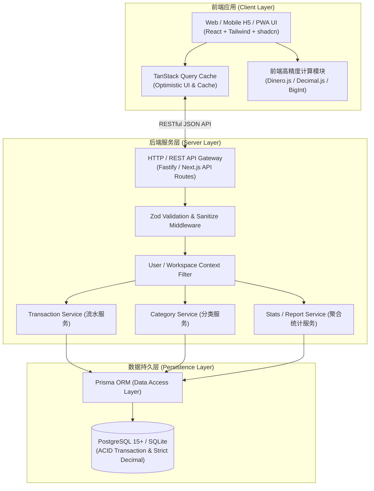

# 个人记账本 MVP 技术架构选型与核心 API 接口定义规格书

---

## 1. 技术栈选型与系统架构设计

### 1.1 选型目标与设计原则
个人记账本 MVP 旨在实现极简、轻量、高响应速度及高可靠性的个人资产管理工具。架构选型遵循以下原则：
1. **轻量与易部署**：单应用或极简前后端分离架构，支持容器化单机一键交付，也支持 Serverless/静态前端 + 轻后端部署。
2. **严格的金融数据一致性**：杜绝浮点数精度损耗，数据模型定义清晰，支持事务与外键完整性。
3. **极佳的交互与离线体验**：兼顾移动端 H5/PWA 与 PC 桌面自适应，首屏秒开，支持离线或弱网乐观更新（Optimistic Updates）。
4. **扩展性**：数据模型预留后续 P1/P2（预算、多币种、多账户资产管理）的演进空间。

### 1.2 推荐技术栈 (Full-Stack TypeScript 方案)

| 层次 | 选型 | 版本/方案 | 选型理由与优势 |
| :--- | :--- | :--- | :--- |
| **前端框架** | **React + Vite / Next.js (App Router)** | React 18+ / Next.js 14+ | 组件生态完备，Vite 构建极快，Next.js 支持 SSR/SSG 与 API Routes 一体化部署 |
| **UI 组件与样式** | **Tailwind CSS + shadcn/ui + Lucide Icons** | Tailwind v3+, Lucide React | 零运行时开销，高自由度，原生自适应移动端与深浅主题切换，图标库丰富 |
| **图表展示** | **Recharts / Chart.js** | Recharts 2.x | 声明式 React 图表库，极佳的环形图/饼图与柱状/折线趋势图支持，包体积适中 |
| **前端状态管理** | **TanStack Query (React Query) + Zustand** | Query v5, Zustand v4 | TanStack Query 完美处理服务端缓存、自动重试与乐观更新；Zustand 负责轻量本地 UI 状态 |
| **后端运行环境** | **Node.js (LTS 20+) / Bun** | TypeScript + Fastify / Express / Next.js API | 统一前后端语言与类型定义（TypeScript Contract Sharing），轻量高效 |
| **ORM / 数据访问** | **Prisma ORM / Drizzle ORM** | Prisma 5+ | 类型安全（Type-safe）、强力的数据迁移工具（Prisma Migrate）、自动生成 TypeScript Client |
| **数据库** | **SQLite (MVP/轻量独立部署) / PostgreSQL 15+ (生产部署)** | SQLite 3 / PG 15+ | SQLite 零外部依赖单文件运行，本地运行与嵌入式首选；PostgreSQL 提供强大 DECIMAL 与时区聚合函数，Prisma 可平滑无缝切换 |
| **输入校验** | **Zod** | Zod 3.x | 运行时 Schema 校验，前后端共享 DTO 校验逻辑，自动推导 TS 类型 |

### 1.3 整体系统架构图



---

## 2. 金额精度与计算规范 (Strict Currency Specification)

为杜绝 IEEE 754 双精度浮点数（如 `0.1 + 0.2 = 0.30000000000000004`）引发的账目不平漏洞，规范如下：

### 2.1 存储规范 (Storage Standard)
- **底层单位标准**：系统内部统一采用**以“分”（Cent）为基本计量单位的 64 位整数（BigInt / INT8）**或**数据库高精度数值类型 `DECIMAL(12, 2)`**。
  - **推荐方案**：
    1. **方案 A（整型分模式 - 生产级硬核规避）**：数据库字段存储 `amount_cents INT8 / BIGINT`（例如 `¥48.50` 存储为 `4850`）。彻底在引擎层面抹平浮点与精度丢失，无运算舍入歧义。
    2. **方案 B（双轨制兼容友好）**：API 交互输入输出支持标准浮点/字符串表示（如 `48.50`），服务端内部与数据库字段统一采用 `DECIMAL(12, 2)` 保证 12 位有效数字与 2 位小数精确度。
  - **金额范围**：正数金额 `(0, 999,999,999.99]`，对应分值为 `1` 到 `99,999,999,999`（完全在安全整型范围内）。

### 2.2 前后端计算与序列化规范
1. **API 数据传输格式**：
   - 响应与请求报文中，交易金额提供标准两位小数数值（如 `48.50`）或同时下发 `amount` (`number`) 与 `amount_cents` (`integer`)，降低前端解析成本。
2. **前端运算标准**：
   - 严禁直接使用原生 JavaScript `+`, `-`, `*`, `/` 运算符计算账单汇总。
   - 前端必须引入 `decimal.js`、`big.js` 或利用原生 `BigInt(Math.round(amount * 100))` 换算为分计算，最终格式化输出：
     ```typescript
     export function formatCurrency(amountCents: number | bigint): string {
       const yuan = Number(amountCents) / 100;
       return new Intl.NumberFormat('zh-CN', {
         style: 'currency',
         currency: 'CNY',
         minimumFractionDigits: 2,
         maximumFractionDigits: 2,
       }).format(yuan);
     }
     ```
3. **服务端聚合计算**：
   - 月度汇总与分类聚合统计均通过 SQL 的 `SUM(amount_cents)` 或 `SUM(amount)` 完成，严禁在应用内存中遍历进行 JS float 累加。

---

## 3. 时区与时间处理规范 (Timezone & Month Boundary)

记账系统高度依赖自然月统计，不同时区的跨月分界差异直接导致流水统计错位。

### 3.1 时区规范定义
1. **服务端存储标准**：数据库所有时间戳（`transaction_time`, `created_at`, `updated_at`）一律存储 **UTC 时间戳**（`TIMESTAMPTZ` / ISO 8601 字符串 `YYYY-MM-DDTHH:mm:ss.sssZ`）。
2. **客户端时区传递**：
   - 所有涉及按月统计、日聚合、区间检索的 API 请求，客户端必须在 Request Header 或 Query 参数中显式传递客户端时区标识（IANA Timezone 规范，例如 `Asia/Shanghai`, `America/New_York`）。
   - 请求头标准：`X-Timezone: Asia/Shanghai`。
   - 若未携带，服务端默认降级按 `Asia/Shanghai` 或 UTC 计算。
3. **服务端自然月与自然日边界计算算法**：
   - 客户端传入自然月参数 `month=2026-11` 及 `timezone=Asia/Shanghai`。
   - 服务端根据目标时区解析该月的自然起止时间点：
     - 月初边界：`2026-11-01 00:00:00.000 (UTC+8)` -> 转换为 UTC: `2026-10-31 16:00:00.000Z`
     - 月末边界：`2026-11-30 23:59:59.999 (UTC+8)` -> 转换为 UTC: `2026-11-30 15:59:59.999Z`
   - 查询区间：`transaction_time >= start_utc AND transaction_time <= end_utc`。
   - SQL 分组（PostgreSQL）：`date_trunc('day', transaction_time AT TIME ZONE 'Asia/Shanghai')`。

---

## 4. 数据库 DDL 与 ORM Schema 设计

### 4.1 Prisma ORM Schema 示例 (`schema.prisma`)

```prisma
datasource db {
  provider = "postgresql" // 可平滑切换为 "sqlite"
  url      = env("DATABASE_URL")
}

generator client {
  provider = "prisma-client-js"
}

enum TransactionType {
  EXPENSE // 支出
  INCOME  // 收入
}

// 分类模型
model Category {
  id           String          @id @default(cuid())
  name         String          @db.VarChar(32)
  type         TransactionType
  icon         String          @db.VarChar(64) // 图标标识符，如 "Utensils", "Bus", "ShoppingBag"
  color        String          @db.VarChar(16) // 十六进制色值，如 "#FF6B6B"
  isDefault    Boolean         @default(false) @map("is_default") // 系统预设不可物理删除
  sortOrder    Int             @default(0) @map("sort_order")
  createdAt    DateTime        @default(now()) @map("created_at")
  updatedAt    DateTime        @updatedAt @map("updated_at")

  transactions Transaction[]

  @@index([type, sortOrder])
  @@map("categories")
}

// 记账单条目模型
model Transaction {
  id              String          @id @default(cuid())
  amountCents     BigInt          @map("amount_cents") // 金额（以分为单位，48.50元存储为4850）
  amount          Decimal         @db.Decimal(12, 2)   // 同步冗余精确小数表示，方便SQL直读
  type            TransactionType
  categoryId      String          @map("category_id")
  transactionTime DateTime        @map("transaction_time") // 发生时间（UTC）
  note            String?         @db.VarChar(255)
  createdAt       DateTime        @default(now()) @map("created_at")
  updatedAt       DateTime        @updatedAt @map("updated_at")

  category        Category        @relation(fields: [categoryId], references: [id], onDelete: Restrict)

  @@index([transactionTime(sort: Desc)])
  @@index([categoryId])
  @@index([type, transactionTime])
  @@map("transactions")
}
```

### 4.2 PostgreSQL 生产级 SQL DDL

```sql
-- 创建枚举类型
CREATE TYPE transaction_type AS ENUM ('EXPENSE', 'INCOME');

-- 1. 创建分类表
CREATE TABLE categories (
    id VARCHAR(36) PRIMARY KEY,
    name VARCHAR(32) NOT NULL,
    type transaction_type NOT NULL,
    icon VARCHAR(64) NOT NULL,
    color VARCHAR(16) NOT NULL DEFAULT '#64748B',
    is_default BOOLEAN NOT NULL DEFAULT FALSE,
    sort_order INT NOT NULL DEFAULT 0,
    created_at TIMESTAMPTZ NOT NULL DEFAULT CURRENT_TIMESTAMP,
    updated_at TIMESTAMPTZ NOT NULL DEFAULT CURRENT_TIMESTAMP
);

CREATE INDEX idx_categories_type_order ON categories (type, sort_order ASC);

-- 2. 创建交易记录表
CREATE TABLE transactions (
    id VARCHAR(36) PRIMARY KEY,
    amount_cents BIGINT NOT NULL CHECK (amount_cents > 0),
    amount DECIMAL(12, 2) NOT NULL CHECK (amount > 0),
    type transaction_type NOT NULL,
    category_id VARCHAR(36) NOT NULL REFERENCES categories(id) ON DELETE RESTRICT,
    transaction_time TIMESTAMPTZ NOT NULL,
    note VARCHAR(255),
    created_at TIMESTAMPTZ NOT NULL DEFAULT CURRENT_TIMESTAMP,
    updated_at TIMESTAMPTZ NOT NULL DEFAULT CURRENT_TIMESTAMP
);

-- 关键性能查询索引
CREATE INDEX idx_transactions_time ON transactions (transaction_time DESC);
CREATE INDEX idx_transactions_cat ON transactions (category_id);
CREATE INDEX idx_transactions_type_time ON transactions (type, transaction_time DESC);

-- 3. 预设种子数据 (Default Seed Categories)
INSERT INTO categories (id, name, type, icon, color, is_default, sort_order) VALUES
-- 支出类 (Expense)
('cat_exp_food', '餐饮美食', 'EXPENSE', 'Utensils', '#EF4444', TRUE, 1),
('cat_exp_traffic', '交通出行', 'EXPENSE', 'Car', '#F97316', TRUE, 2),
('cat_exp_shopping', '日用百货', 'EXPENSE', 'ShoppingBag', '#F59E0B', TRUE, 3),
('cat_exp_fun', '休闲娱乐', 'EXPENSE', 'Gamepad2', '#8B5CF6', TRUE, 4),
('cat_exp_digital', '数码电器', 'EXPENSE', 'Smartphone', '#3B82F6', TRUE, 5),
('cat_exp_housing', '住房缴费', 'EXPENSE', 'Home', '#06B6D4', TRUE, 6),
('cat_exp_medical', '医疗保健', 'EXPENSE', 'HeartPulse', '#EC4899', TRUE, 7),
('cat_exp_clothes', '服饰美容', 'EXPENSE', 'Sparkles', '#10B981', TRUE, 8),
('cat_exp_other', '其他支出', 'EXPENSE', 'MoreHorizontal', '#64748B', TRUE, 9),
-- 收入类 (Income)
('cat_inc_salary', '工资薪酬', 'INCOME', 'Wallet', '#10B981', TRUE, 1),
('cat_inc_bonus', '奖金津贴', 'INCOME', 'Award', '#059669', TRUE, 2),
('cat_inc_parttime', '兼职外包', 'INCOME', 'Briefcase', '#3B82F6', TRUE, 3),
('cat_inc_invest', '理财投资', 'INCOME', 'TrendingUp', '#6366F1', TRUE, 4),
('cat_inc_gift', '人情红包', 'INCOME', 'Gift', '#EC4899', TRUE, 5),
('cat_inc_other', '其他收入', 'INCOME', 'Coins', '#64748B', TRUE, 6);
```

---

## 5. RESTful API 接口规格定义 (API Contract)

### 5.1 全局统一约定
- **Base URL**: `/api/v1`
- **Content-Type**: `application/json`
- **公共响应封装规范**:
  ```typescript
  interface ApiResponse<T> {
    success: boolean;
    data: T;
    error?: {
      code: string;
      message: string;
      details?: any;
    };
    timestamp: string; // ISO 8601
  }
  ```
- **通用错误码**:
  - `BAD_REQUEST` (400): 参数校验不合法
  - `NOT_FOUND` (404): 记录不存在
  - `CATEGORY_IN_USE` (409): 分类下存在交易记录，无法删除
  - `INTERNAL_SERVER_ERROR` (500): 系统内部异常

---

### 5.2 交易明细模块 (Transactions)

#### 1. 创建交易记录
- **Endpoint**: `POST /api/v1/transactions`
- **Request Body**:
  ```json
  {
    "type": "EXPENSE",
    "amount": 48.50,
    "categoryId": "cat_exp_food",
    "transactionTime": "2026-11-22T12:15:00.000Z",
    "note": "中午和同事聚餐"
  }
  ```
- **Validation Rules**:
  - `type`: 必填，枚举 `EXPENSE` | `INCOME`
  - `amount`: 必填，数字，`0.01 <= amount <= 999999999.99`，最多2位小数
  - `categoryId`: 必填，有效分类ID，分类类型需与交易类型严格匹配
  - `transactionTime`: 必填，合法 ISO 8601 时间格式
  - `note`: 选填，字符串，最多 100 字符
- **Response**: `201 Created`
  ```json
  {
    "success": true,
    "data": {
      "id": "tx_01a...",
      "type": "EXPENSE",
      "amount": 48.50,
      "amountCents": 4850,
      "categoryId": "cat_exp_food",
      "category": {
        "id": "cat_exp_food",
        "name": "餐饮美食",
        "icon": "Utensils",
        "color": "#EF4444"
      },
      "transactionTime": "2026-11-22T12:15:00.000Z",
      "note": "中午和同事聚餐",
      "createdAt": "2026-11-22T12:15:30.000Z"
    },
    "timestamp": "2026-11-22T12:15:30.000Z"
  }
  ```

#### 2. 分页/按月查询交易明细列表
- **Endpoint**: `GET /api/v1/transactions`
- **Query Parameters**:
  - `month` (可选，格式 `YYYY-MM`，如 `2026-11`)：指定月份
  - `type` (可选，`EXPENSE` | `INCOME` | `ALL`，默认 `ALL`)
  - `categoryId` (可选，按分类过滤)
  - `page` (可选，默认 `1`)
  - `pageSize` (可选，默认 `20`，上限 `100`)
- **Headers**:
  - `X-Timezone`: `Asia/Shanghai`
- **Response**: `200 OK`
  ```json
  {
    "success": true,
    "data": {
      "items": [
        {
          "id": "tx_01a...",
          "type": "EXPENSE",
          "amount": 48.50,
          "amountCents": 4850,
          "categoryId": "cat_exp_food",
          "category": {
            "id": "cat_exp_food",
            "name": "餐饮美食",
            "icon": "Utensils",
            "color": "#EF4444"
          },
          "transactionTime": "2026-11-22T12:15:00.000Z",
          "note": "中午和同事聚餐",
          "createdAt": "2026-11-22T12:15:30.000Z"
        }
      ],
      "pagination": {
        "page": 1,
        "pageSize": 20,
        "total": 156,
        "totalPages": 8,
        "hasMore": true
      },
      "monthSummary": {
        "month": "2026-11",
        "totalExpense": 3280.50,
        "totalIncome": 12000.00,
        "balance": 8719.50
      }
    },
    "timestamp": "2026-11-22T12:30:00.000Z"
  }
  ```

#### 3. 获取单笔交易详情
- **Endpoint**: `GET /api/v1/transactions/{id}`
- **Response**: `200 OK` (返回单条 Transaction 结构)

#### 4. 更新单笔交易记录
- **Endpoint**: `PUT /api/v1/transactions/{id}`
- **Request Body**: 同创建接口结构，支持全量/部分字段修改
- **Response**: `200 OK` (返回更新后的 Transaction 结构)

#### 5. 删除交易记录
- **Endpoint**: `DELETE /api/v1/transactions/{id}`
- **Response**: `200 OK`
  ```json
  {
    "success": true,
    "data": {
      "id": "tx_01a...",
      "deleted": true
    },
    "timestamp": "2026-11-22T12:35:00.000Z"
  }
  ```

---

### 5.3 分类管理模块 (Categories)

#### 1. 获取分类列表
- **Endpoint**: `GET /api/v1/categories`
- **Query Parameters**:
  - `type` (可选，`EXPENSE` | `INCOME`)
- **Response**: `200 OK`
  ```json
  {
    "success": true,
    "data": [
      {
        "id": "cat_exp_food",
        "name": "餐饮美食",
        "type": "EXPENSE",
        "icon": "Utensils",
        "color": "#EF4444",
        "isDefault": true,
        "sortOrder": 1,
        "transactionCount": 42
      }
    ],
    "timestamp": "2026-11-22T12:00:00.000Z"
  }
  ```

#### 2. 新增自定义分类
- **Endpoint**: `POST /api/v1/categories`
- **Request Body**:
  ```json
  {
    "name": "猫咪宠物",
    "type": "EXPENSE",
    "icon": "Cat",
    "color": "#F472B6",
    "sortOrder": 10
  }
  ```
- **Validation**:
  - `name`: 必填，1-32 字符，同类型下不可重名
  - `type`: 必填，`EXPENSE` | `INCOME`
  - `icon`: 必填，字符串
  - `color`: 必填，十六进制合法色值（如 `#RRGGBB`）
- **Response**: `201 Created`

#### 3. 更新分类
- **Endpoint**: `PUT /api/v1/categories/{id}`
- **Request Body**:
  ```json
  {
    "name": "宠物开销",
    "icon": "Dog",
    "color": "#EC4899",
    "sortOrder": 5
  }
  ```
- **说明**: 系统预置分类（`isDefault=true`）允许自定义修改其名称、图标和颜色，但不允许变更其 `type`。

#### 4. 删除分类（带关联校验拦截）
- **Endpoint**: `DELETE /api/v1/categories/{id}`
- **业务校验逻辑**:
  1. 若该分类为系统预置分类（`isDefault=true`），拒绝删除，返回 `403 Forbidden` (`CANNOT_DELETE_DEFAULT_CATEGORY`)。
  2. 若该分类下存在已关联的交易明细记录（`transactions.count > 0`），拦截删除并返回关联数量，拒绝物理删除，返回 `409 Conflict`。
- **Response (409 Conflict 拦截示例)**:
  ```json
  {
    "success": false,
    "error": {
      "code": "CATEGORY_IN_USE",
      "message": "该分类下存在 18 笔账单，不可直接删除。请先迁移账单或修改账单分类。",
      "details": {
        "categoryId": "cat_custom_pet",
        "transactionCount": 18
      }
    },
    "timestamp": "2026-11-22T12:00:00.000Z"
  }
  ```
- **Response (200 OK 成功示例)**:
  ```json
  {
    "success": true,
    "data": {
      "id": "cat_custom_pet",
      "deleted": true
    },
    "timestamp": "2026-11-22T12:00:00.000Z"
  }
  ```

---

### 5.4 统计与报表模块 (Analytics & Dashboard)

#### 1. 月度财务概览 (Overview Cards)
- **Endpoint**: `GET /api/v1/stats/overview`
- **Query Parameters**:
  - `month` (必填，格式 `YYYY-MM`，如 `2026-11`)
- **Headers**:
  - `X-Timezone`: `Asia/Shanghai`
- **Response**: `200 OK`
  ```json
  {
    "success": true,
    "data": {
      "month": "2026-11",
      "totalIncome": 12500.00,
      "totalIncomeCents": 1250000,
      "totalExpense": 4210.80,
      "totalExpenseCents": 421080,
      "balance": 8289.20,
      "balanceCents": 828920,
      "transactionCount": 68,
      "comparisonLastMonth": {
        "expenseGrowthRate": -0.052,
        "incomeGrowthRate": 0.083
      }
    },
    "timestamp": "2026-11-22T12:00:00.000Z"
  }
  ```

#### 2. 分类支出/收入占比结构分析 (Category Distribution)
- **Endpoint**: `GET /api/v1/stats/category-distribution`
- **Query Parameters**:
  - `month` (必填，格式 `YYYY-MM`)
  - `type` (可选，默认 `EXPENSE`，支持 `EXPENSE` | `INCOME`)
- **Response**: `200 OK`
  ```json
  {
    "success": true,
    "data": {
      "month": "2026-11",
      "type": "EXPENSE",
      "totalAmount": 4210.80,
      "items": [
        {
          "categoryId": "cat_exp_food",
          "categoryName": "餐饮美食",
          "icon": "Utensils",
          "color": "#EF4444",
          "amount": 1680.00,
          "amountCents": 168000,
          "percentage": 0.3989,
          "transactionCount": 35
        },
        {
          "categoryId": "cat_exp_housing",
          "categoryName": "住房缴费",
          "icon": "Home",
          "color": "#06B6D4",
          "amount": 1200.00,
          "amountCents": 120000,
          "percentage": 0.2850,
          "transactionCount": 1
        },
        {
          "categoryId": "cat_exp_traffic",
          "categoryName": "交通出行",
          "icon": "Car",
          "color": "#F97316",
          "amount": 450.80,
          "amountCents": 45080,
          "percentage": 0.1071,
          "transactionCount": 18
        }
      ]
    },
    "timestamp": "2026-11-22T12:00:00.000Z"
  }
  ```

#### 3. 月内日趋势流水 (Daily Trend)
- **Endpoint**: `GET /api/v1/stats/daily-trend`
- **Query Parameters**:
  - `month` (必填，格式 `YYYY-MM`)
- **Headers**:
  - `X-Timezone`: `Asia/Shanghai`
- **Response**: `200 OK`
  ```json
  {
    "success": true,
    "data": {
      "month": "2026-11",
      "days": [
        {
          "date": "2026-11-01",
          "expense": 150.00,
          "income": 0.00
        },
        {
          "date": "2026-11-10",
          "expense": 88.50,
          "income": 12000.00
        }
      ]
    },
    "timestamp": "2026-11-22T12:00:00.000Z"
  }
  ```

---

## 6. 下游交付与开发落地建议

1. **前后端接口联调**：
   - 建议在开发阶段使用基于 Zod Schema 自动生成的 Mock 数据或 `msw` (Mock Service Worker) 提供脱机本地开发支持。
2. **测试与断言基准**：
   - 金额单元测试用例需覆盖 `0.01`、负数拦截、多位小数格式化舍入；
   - 跨月边界测试用例覆盖 `2026-10-31 23:59:59 (UTC+8)` 与 `2026-11-01 00:00:00 (UTC+8)`，断言其落在正确的聚合月。
