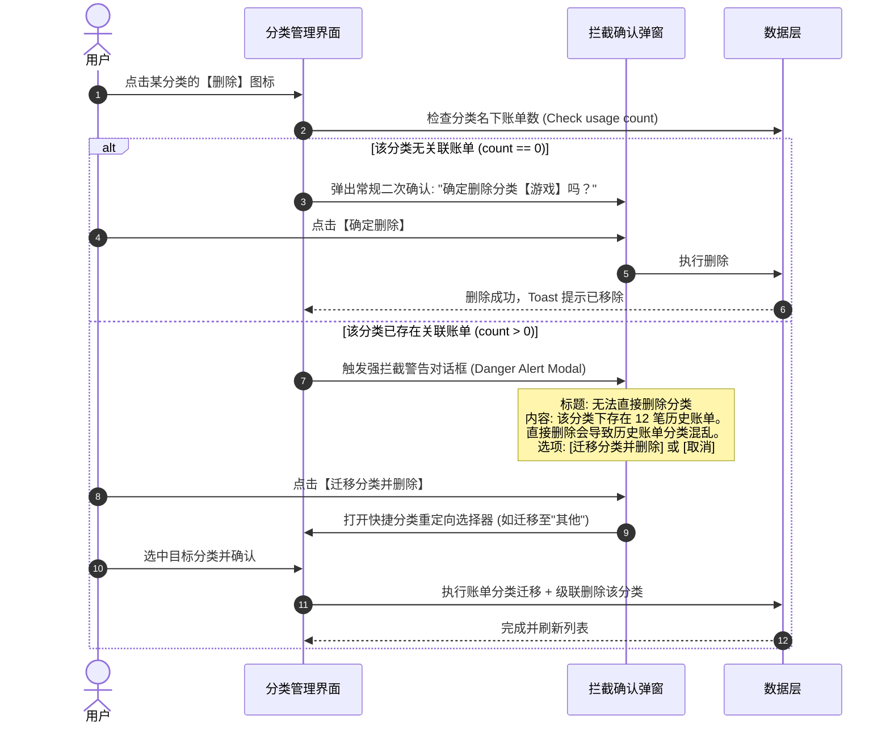

# 个人记账本核心页面原型与交互设计规范 (UI/UX Specification)

---

## 1. 设计概述与设计语言体系 (Design System)

为贯彻“记账快速、分类直观、统计明了、操作零门槛”的产品定位，设计规范遵循 **轻量极简、触控友好、色彩表意清晰、反馈即时** 四大原则。

### 1.1 基础色彩规范 (Color Tokens)

记账系统高度依赖色彩传递财务属性。针对收支色彩表意，支持符合中国国内用户认知的主流模式（红支绿收），并提供柔和高对比度色彩以避免视觉疲劳。

| Token 名称 | 颜色色值 (HEX) | 语义与应用场景 | 对比度基准 (WCAG AA) |
| :--- | :--- | :--- | :--- |
| `--color-expense` | `#F43F5E` (Rose 500) | **支出核心色**：支出金额、支出标签、扣减类视觉指示 | 对纯白背景对比度 ≥ 4.5:1 |
| `--color-expense-bg` | `#FFF1F2` (Rose 50) | 支出分类背景气泡、支出选中状态底色 | 弱化背景，突出文本 |
| `--color-income` | `#10B981` (Emerald 500) | **收入核心色**：收入金额、收入标签、收益类视觉指示 | 对纯白背景对比度 ≥ 4.5:1 |
| `--color-income-bg` | `#ECFDF5` (Emerald 50) | 收入分类背景气泡、收入选中状态底色 | 弱化背景，突出文本 |
| `--color-balance` | `#3B82F6` (Blue 500) | **结余/资产核心色**：仪表盘总结余卡片、主品牌色 | 对纯白背景对比度 ≥ 4.5:1 |
| `--color-text-primary` | `#0F172A` (Slate 900) | 一级文本：主标题、核心金额数字 | 极高对比度 (≥ 12:1) |
| `--color-text-secondary`| `#475569` (Slate 600) | 二级文本：列表分类名、表单标签、副标题 | 高对比度 (≥ 5.5:1) |
| `--color-text-muted` | `#94A3B8` (Slate 400) | 三级辅助：时间戳、占位符、无重要备注 | 辅助文本 (≥ 3.2:1) |
| `--color-bg-canvas` | `#F8FAFC` (Slate 50) | 全局页面背景底色 | 浅灰色衬底，增强卡片层次 |
| `--color-bg-card` | `#FFFFFF` (White) | 卡片容器、弹窗抽屉、表单背景 | 干净纯白 |
| `--color-border` | `#E2E8F0` (Slate 200) | 分割线、表单输入框边框、卡片浅描边 | 柔和分割线 |
| `--color-danger` | `#EF4444` (Red 500) | 破坏性操作警告、删除确认弹窗 | 危险告警 |

### 1.2 字体排印与排版规范 (Typography)

* **字体族 (Font Family)**：
  - 中文界面：`system-ui, -apple-system, BlinkMacSystemFont, "PingFang SC", "Hiragino Sans GB", "Microsoft YaHei", sans-serif`
  - 金额数字与时间：推荐开启表格等宽数字特性 (`font-feature-settings: "tnum"`)，确保金额小数点和千分位在列表中严格对齐。
* **字号与层级阶梯**：
  - `Display / Amount (大键盘/卡片金额)`: `32px` ~ `36px`，`Font-weight: 700` (Bold)
  - `H1 / Page Title (页面主标题)`: `22px`，`Font-weight: 600` (Semi-bold)
  - `H2 / Section Title (模块标题/分组日期)`: `16px`，`Font-weight: 600`
  - `Body Regular (正文文本/明细条目)`: `15px`，`Font-weight: 400`
  - `Caption (辅助说明/时间/状态)`: `12px` ~ `13px`，`Font-weight: 400`

### 1.3 间距与圆角栅格体系 (Spacing & Radii)

* **间距基数**：基于 4px / 8px 栅格倍数体系
  - `spacing-xs`: `4px`
  - `spacing-sm`: `8px`
  - `spacing-md`: `16px` (移动端标准侧边距与卡片内边距)
  - `spacing-lg`: `24px`
  - `spacing-xl`: `32px`
* **圆角规范 (Border Radius)**：
  - 微型组件 (Tag/Badge): `4px` ~ `6px`
  - 按钮与输入框: `10px` ~ `12px`
  - 核心卡片容器 (Card): `16px`
  - 底部抽屉面板 (Bottom Sheet Modal): `24px 24px 0 0`
  - 浮动操作按钮 (FAB) / 分类图标背景: 纯圆全曲率 (`9999px` 或 `50%`)

---

## 2. 核心页面信息架构与布局原型 (Wireframes & Layouts)

### 2.1 整体信息架构导航图 (IA Map)

```mermaid
graph TD
    App[个人记账本 App]
    App --> TabHome[1. 首页 Dashboard]
    App --> TabList[2. 账单明细流水]
    App --> TabCategory[3. 分类管理与设置]
    App --> QuickModal[4. 快速记账模态面板 (全局FAB触发)]

    TabHome --> QuickModal
    TabList --> QuickModal
    TabCategory --> CategoryEditModal[新增/编辑分类抽屉]
    TabList --> TxDetailModal[账单详情/修改面板]
```

---

### 2.2 核心页面 1：首页数据概览 Dashboard

**页面目标**：让用户在 1 秒内清晰了解当月收支总体概貌、结余健康度以及开销分布。

#### 线框布局草案 (ASCII Wireframe)

```
+---------------------------------------------------+
|  [Logo/Title: 个人记账本]          [月度选择: 2026年11月 v] |
+---------------------------------------------------+
| +-- [总览卡片 Card] ------------------------------+ |
| |  本月结余 (元)                                   | |
| |  ¥ 4,820.50                      [净储蓄率 35%]  | |
| |  ---------------------------------------------  | |
| |  本月总支出 (Rose)         本月总收入 (Emerald)    | |
| |  ¥ 8,960.00               ¥ 13,780.50           | |
| +-------------------------------------------------+ |
|                                                   |
| +-- [当月支出分类占比 (环形图/进度条)] -------------+ |
| |  分类支出分布 (共 ¥8,960.00)                      | |
| |         ( O )   1. 餐饮美食: ¥3,584 (40%) [==== ] | |
| |        环形图   2. 住房物业: ¥2,688 (30%) [===  ] | |
| |                 3. 交通出行: ¥1,344 (15%) [==   ] | |
| |                 4. 休闲娱乐: ¥896   (10%) [=    ] | |
| |                 5. 其他分类: ¥448   (5%)  [     ] | |
| +-------------------------------------------------+ |
|                                                   |
| +-- [最近动态 (最新3条流水)] ------- [查看全部 >] -+ |
| |  (餐) 麦当劳晚餐       今天 18:20        -¥ 38.50 | |
| |  (车) 地铁充值         今天 08:45        -¥ 50.00 | |
| |  (薪) 11月工资发放     昨天 10:00    +¥ 13,780.50 | |
| +-------------------------------------------------+ |
|                                                   |
|                 [ ( + ) 快速记账 FAB ]             |
| [ 首页 (选中) ]         [ 明细列表 ]         [ 分类设置 ] |
+---------------------------------------------------+
```

#### 关键交互逻辑
1. **年月切换**：点击顶部年月选择器呼出滚轮/下拉月份选择，切换后仪表盘卡片与环形图实时触发淡入加载动画。
2. **环形图联动**：点击右侧分类项或环形图对应扇区，高亮该分类切片，中心显示该分类金额与占比。
3. **全局记账悬浮按钮 (FAB)**：常驻界面中下部或底部导航栏中心，带有微投影与呼吸按压动效。

---

### 2.3 核心页面 2：快速记账表单 (弹窗/底部抽屉)

**页面目标**：极速录入体验，支持单手盲打，尽量减少键盘弹起时的屏幕跳动。

#### 线框布局草案 (ASCII Wireframe)

```
+---------------------------------------------------+
|                  [ 拖拽手柄条 --- ]                 |
|  [取消 / X]             记一笔              [保存 (勾)] |
+---------------------------------------------------+
|           [  ● 支出 (选中)  ]     [   收入   ]        |
|                                                   |
|   金额显示区 (单手大字号):                           |
|   ¥ 48.50|                                        |
+---------------------------------------------------+
| 分类选择网格 (水平滑动 / 4x2 网格图标):            |
|   [ (餐) ]     [ (车) ]     [ (购) ]     [ (娱) ] |
|   餐饮美食     交通出行     日常购物     休闲娱乐  |
|                                                   |
|   [ (房) ]     [ (医) ]     [ (人) ]     [ ( + )] |
|   住房物业     医疗保健     人情往来     添加分类  |
+---------------------------------------------------+
| 辅助项行 (极简紧凑):                               |
|   [ 📅 今天 12:15 v ]   [ 🏷️ 备注: 麦当劳午餐... ] |
+---------------------------------------------------+
| 大按键定制数字键盘 (Numeric Keypad):                |
|   +-----------+-----------+-----------+---------+ |
|   |     1     |     2     |     3     |  今天   | |
|   +-----------+-----------+-----------+---------+ |
|   |     4     |     5     |     6     |   +     | |
|   +-----------+-----------+-----------+---------+ |
|   |     7     |     8     |     9     |   -     | |
|   +-----------+-----------+-----------+---------+ |
|   |     .     |     0     |    ⌫ 退格 |  完成/  | |
|   |           |           |           |  再记一笔| |
|   +-----------+-----------+-----------+---------+ |
+---------------------------------------------------+
```

#### 交互细节与状态机说明
1. **首焦与录入流程**：
   - 弹窗呼出时，默认聚焦于金额，数字键盘立即可用。
   - 默认选中支出类型，分类默认高亮第一项（或用户最常用的分类）。
2. **定制数字键盘功能**：
   - 支持简易算式输入（如 `35 + 13.5`），在按键区直接计算，免除用户跳出切换计算器的痛点。
   - “⌫” 长按快速清空金额。
   - 小数点规则：已有小数点后最多允许输入 2 位，禁止多次输入点号。
3. **“完成” 与 “再记一笔”**：
   - 单击“完成”：提交数据，轻震动反馈（Haptic），Toast 提示“已记一笔”，抽屉顺滑向下收起。
   - 长按或切换“再记一笔”选项：保存当前数据并清空金额/备注，保持在当前页面，方便批量记账。

---

### 2.4 核心页面 3：账单明细流水列表页

**页面目标**：高效查账、对账与删除修改，支持按自然日聚合展示与收支色彩对比。

#### 线框布局草案 (ASCII Wireframe)

```
+---------------------------------------------------+
| 账单明细流水                    [ 筛选: 全部收支 v ]|
| 当前月: [ < 2026年11月 > ]                          |
| 月支出: ¥8,960.00         月收入: ¥13,780.50        |
+---------------------------------------------------+
| [日分组 Header] 11月22日 今天          支 ¥88.50   |
| +-----------------------------------------------+ |
| | (餐) 餐饮美食 - 麦当劳晚餐           -¥38.50   | |
| |      18:20 | 个人消费                           | |
| +-----------------------------------------------+ |
| | (车) 交通出行 - 地铁单程票           -¥50.00   | |
| |      08:45 | 交通卡充值                         | |
| +-----------------------------------------------+ |
|                                                   |
| [日分组 Header] 11月21日 昨天     支 ¥120 收 ¥13,780 |
| +-----------------------------------------------+ |
| | (薪) 工资薪酬 - 11月份基本工资   +¥13,780.50 (绿) |
| |      10:00 | 公司打款                           | |
| +-----------------------------------------------+ |
| | (购) 日常购物 - 超市日用品          -¥120.00 (红) |
| |      [向左滑动: <<< 显示 [编辑] [删除] 按钮 ]   | |
| +-----------------------------------------------+ |
|                                                   |
|                  已加载全部本月明细                |
+---------------------------------------------------+
```

#### 列表交互细节
1. **日分组统计**：列表以日期降序聚合，日头部清楚列出“当天的总支出”与“总收入”。
2. **金额表意**：
   - 支出条目：数字前置负号 `-¥`，字体颜色采用 `--color-expense` 或稳重的主文本色配高亮负号。
   - 收入条目：数字前置加号 `+¥`，字体颜色采用 `--color-income` 鲜明呈现。
3. **单项交互（滑动与点击）**：
   - **点击**：从底部弹出“账单详情卡片”，展示完整字段、创建时间，提供“修改”按钮。
   - **向左滑动手势**：露出快速操作抽屉，红色按钮为“删除”，灰色按钮为“编辑”。
   - **删除确认**：点击删除后弹出轻量 ActionSheet / 二次防误触弹窗（“确定删除这笔 ¥120.00 的账单吗？”）。

---

### 2.5 核心页面 4：分类管理页与拦截保护机制

**页面目标**：直观管理预设与自定义标签，提供强严密的账单关联保护与拦截提示。

#### 线框布局草案 (ASCII Wireframe)

```
+---------------------------------------------------+
| < 返回设置         分类管理            [ + 新增分类 ] |
+---------------------------------------------------+
| 分类类型切换:     [ 支出分类 (8) ]     [ 收入分类 (4) ]|
+---------------------------------------------------+
| [系统预设分类 (不可删除，支持自定义图标与排序)]     |
|  :: (餐) 餐饮美食                        [预设] > |
|  :: (车) 交通出行                        [预设] > |
|  :: (购) 日常购物                        [预设] > |
|  :: (房) 住房物业                        [预设] > |
|                                                   |
| [自定义分类 (支持重命名、修改图标颜色与删除)]       |
|  :: (猫) 宠物开销 (关联 12 笔账单)      [编辑] [🗑️] |
|  :: (游) 蒸汽平台游戏 (关联 0 笔账单)   [编辑] [🗑️] |
+---------------------------------------------------+
```

#### 删除关联账单的拦截提示弹窗交互流程 (Flow)



---

## 3. 交互微动作与动态体验规范 (Micro-Interactions & States)

良好的财务应用需要兼具安全感与轻快感。以下为全流程微动作规范：

### 3.1 触摸与点击反馈 (Feedback)
1. **触控涟漪/缩放反馈**：
   - 核心按钮（记账 FAB、键盘按键、保存按钮）按下时应用 CSS 微缩放：`transform: scale(0.96); transition: transform 80ms ease-out;`。
   - 移动端启用 Native 触觉轻震动反馈（Haptic Light Impact），每次按键提供极其微弱的物理回馈感。
2. **Toast 提示规范**：
   - 页面顶部或中下部悬浮圆角胶囊组件，停留时长 `1500ms`，自带轻微下落淡入动画。
   - 场景分类：
     - **成功 (Success)**：翠绿图标 + "记账成功" / "分类已保存"。
     - **警示/拦截 (Warning)**：琥珀色图标 + "金额必须大于 0" / "请选择分类"。
     - **错误 (Error)**：玫瑰红图标 + "网络异常，数据已暂存本地"。

### 3.2 骨架屏加载与过度动画 (Skeleton & Transitions)
1. **首页与列表骨架屏 (Skeleton Screens)**：
   - 拒绝大面积单一的转圈 Loading；首屏加载时采用灰色呼吸脉冲块（Shimmer Effect），保持原页面卡片和列表外框结构稳定，消除视觉跳动与抖动（CLS = 0）。
2. **模态抽屉展开动画**：
   - 快速记账抽屉弹出遵循贝塞尔曲线：`cubic-bezier(0.16, 1, 0.3, 1)`，用时 `260ms`，背景蒙层（Backdrop）从 `rgba(0,0,0,0)` 渐变为 `rgba(0,0,0,0.4)`。

### 3.3 空状态设计 (Empty States)
* **当月无账单流水**：
  - 插画/图标：极简线描的储蓄罐或展开的空白账本。
  - 文案主标：“这个月还没有任何收支记录呢~”
  - 文案副标：“保持记账习惯，是财富自由的第一步。”
  - 行动按钮 (CTA)：按钮带有显著主色，“[ + 马上记一笔 ]”，直接唤起快速记账抽屉。
* **搜索/筛选无结果**：
  - 文案：“未找到匹配的账单条目，尝试更换筛选月份或分类。”

---

## 4. 响应式与多端适配考量 (Mobile & Desktop)

| 视口形态 | 推荐宽度 | 布局特征 | 记账录入表现 |
| :--- | :--- | :--- | :--- |
| **移动端 (Mobile First)** | `< 640px` | 单列流式布局、底部常驻 Tab 导航 + 居中凸起记账 FAB | 底部上滑半屏抽屉 (Bottom Sheet)，大尺寸软键盘 |
| **平板 / 宽屏 (Desktop)** | `≥ 640px` | 左右分栏或居中卡片容器 (最大宽 768px - 1024px) | 居中对话框 (Modal Dialog)，自动映射物理键盘数字键与回车 |

---

## 5. 交付总结与下游团队协作导引

- **前端工程师 (TASK-3下游)**：重点关注设计系统 Tokens、CSS 变量命名、金额大键盘的无光标防跳动实现，以及日分组流水列表的虚拟滚动方案。
- **测试工程师 (QA)**：重点验证分类拦截删除流程的分支路径覆盖、数字键盘极限输入（连续按点、算式溢出）、以及不同设备屏幕下抽屉手势的跟手性。
